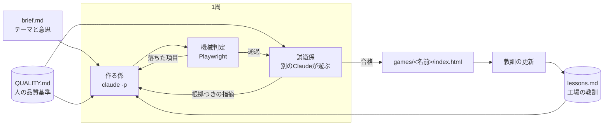

# ブラウザゲーム工場（Game Factory）

テーマと意思を書いた brief を1枚置くと、ブラウザゲームを作り、**初見のAIプレイヤーに実際に遊ばせて**、合格するまで自分で直し続けるソフトウェアファクトリーです。生成中に人は見ませんし、生成物を手で直すこともしません。



## しくみ

| 段 | 何をするか | AI? |
| -- | -- | -- |
| 作る係 | brief・契約・教訓・前回の評価を読んで `index.html` を作る／直す | Claude Code (`claude -p`) |
| 機械判定 | 外部参照なし、構文OK、読み込みでエラー0件、`window.__game` がある、Space/Enterで始まる、入力で画面が変わる、ランダム操作（キーとクリック）90秒でエラーなし・レイアウトシフトなし、やり直せる | なし |
| 試遊係 | ブラウザで実際に遊び、スクショを根拠に9項目（遊びやすさ6項目＋品質基準のグラフィック・画面の安定・ボリューム）を1〜5で採点し、修正依頼を最大3つ出す | 別の Claude |
| 教訓の更新 | ラン全体の失敗から、次の別ゲームにも効く一般的な教訓を `lessons.md` に書き戻す | Claude |

ポイントは3つです。

- **ジャンルを知らない評価器。** ゲームは [CONTRACT.md](CONTRACT.md) の `window.__game`（state と score）を出すことだけが約束です。評価器はこれと画面の変化だけを見るので、避けゲーでもパズルでも同じ評価器が使えます。
- **時間を止めて遊ぶ。** 試遊中はゲーム内の時計が止まっていて、AIが行動したときだけ進みます（Playwright の clock）。AIの考える時間でゲームオーバーになりません。乱数も固定するので、「入力あり／なし」の画面比較が機械的にできます。
- **人の基準とAIの教訓を分ける。** 人が遊んで気づいたこと（文字だけの画面にしない、レイアウトを揺らさない、ボリューム）は [QUALITY.md](QUALITY.md) に人が書き、作る係と試遊係の両方に渡します。機械で測れるもの（レイアウトシフト）は機械判定にも入れます。
- **工場が育つ。** 1本作り終えるたびに教訓を更新し、次のゲームの作る係に渡します。個々のゲームではなく、次の生成物も良くなる仕組みです。

止め時は、機械判定がすべて通り試遊点が合格ライン（既定0.75）を超えたとき。周回上限（既定6）、費用上限（既定$10）、3周続けてベストが更新されないときも止まります。出荷するのは最後の周ではなく**ベストの周**です。

## 使い方

必要なもの: Node.js 20以上、ログイン済みの [Claude Code](https://docs.claude.com/en/docs/claude-code)（`claude` コマンド）。

```bash
npm install
npx playwright install chromium
npm test                                   # 工場の自己テスト（ブラウザ込み）
npm run factory -- briefs/dodge.md         # 本番。games/dodge/index.html ができる
```

主なオプション:

```bash
npm run factory -- briefs/dodge.md --max-rounds 6 --threshold 0.75 --patience 3 --max-cost 10 --actions 60
npm run factory -- briefs/dodge.md --mock   # AIを呼ばずに配線だけ確認（見本ゲームを使う）
npm run gate -- games/dodge/index.html      # 機械判定だけを単独で
```

環境変数: `FACTORY_MODEL`（モデル指定）、`FACTORY_BUDGET_PER_CALL`（1回の呼び出しの費用上限USD）、`FACTORY_CHROME`（使うChromeのパス）。

新しいゲームは `briefs/` に Markdown を1枚足すだけです。書き方は [briefs/dodge.md](briefs/dodge.md) を参照してください。

## 出力

```
games/<名前>/index.html          出荷したゲーム（ベストの周）
runs/<名前>/<日時>/
  report.md                      スコア推移・各周の指摘・スクショ（発表用）
  summary.json                   全周回の機械判定と試遊の結果
  round-N/index.html             その周のゲーム
  round-N/gate.json, gate-*.png  機械判定
  round-N/playtest.json          試遊の採点と指摘
  round-N/play/NNN.png           試遊AIが見た画面（1手ごと）
  round-N/play-log.jsonl         試遊AIの操作ログ
lessons.md                       工場の教訓（ランごとにAIが更新）
QUALITY.md                       人の品質基準（人が更新）
```

発表は `games/` のゲームを遊んでもらい、そのあと `report.md` でスコアの推移と試遊AIの指摘を見せる流れを想定しています。

## ハッカソンのルールとの対応

- 生成中の人のレビュー: なし。人が触るのは brief だけ。
- 生成物の手修正: なし。修正は作る係だけが行う。
- AIによるレビューと修正: 機械判定と試遊AIの指摘を毎周回、作る係に戻す。
- ファクトリー自体の改善: `lessons.md` を毎ラン更新。評価器はジャンル非依存で再利用できる。

`factory/fixtures/` のゲームは評価器のテスト用の見本で、工場の生成物ではありません。

## 構成

```
factory/
  run.mjs           メインループ
  build.mjs         作る係
  gate.mjs          機械判定
  static-check.mjs  ブラウザ不要の事前チェック
  playtest.mjs      試遊係（AIプレイヤーを起動して採点を回収）
  play-server.mjs   時間を止めたゲームを保持するローカルサーバー
  play.mjs          試遊AIが叩く操作コマンド
  lessons.mjs       教訓の更新
  report.mjs        レポート
  prompts/          各係のプロンプト
  selftest.mjs      自己テスト
```
