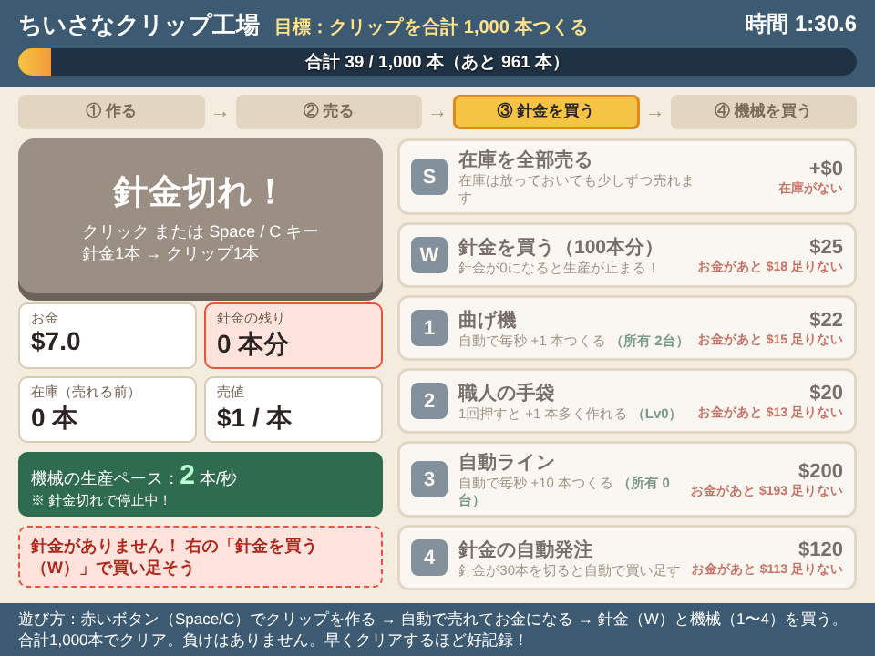
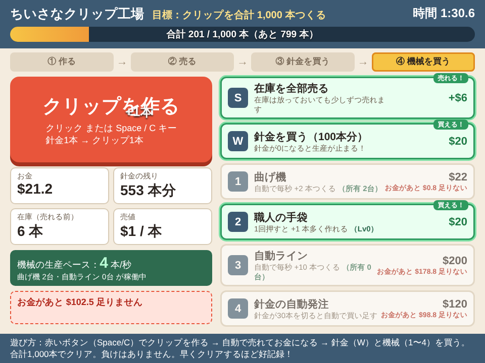
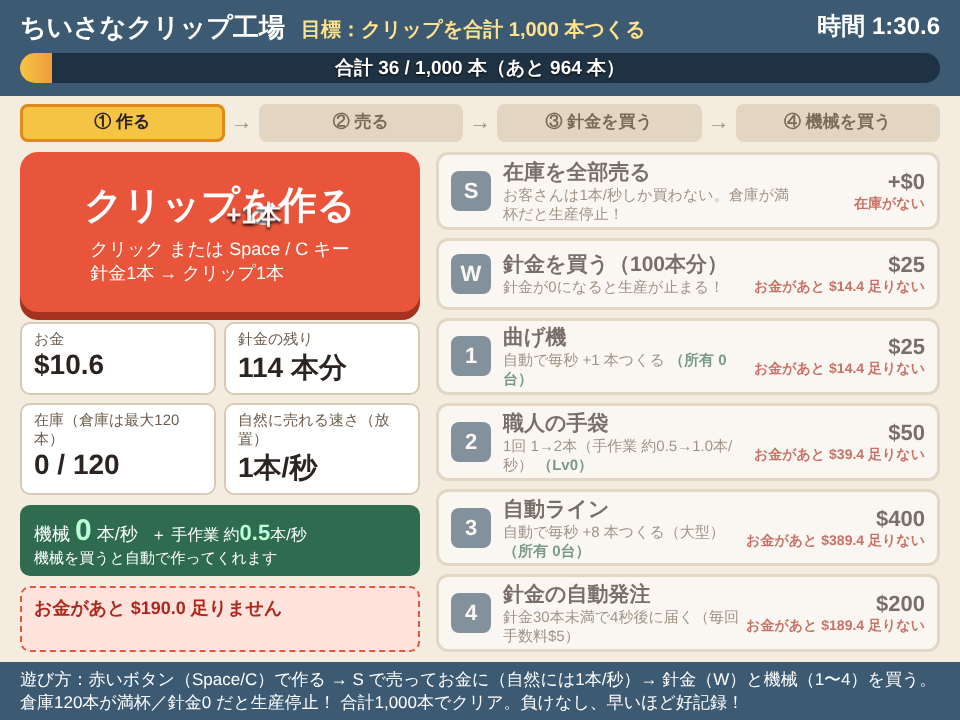
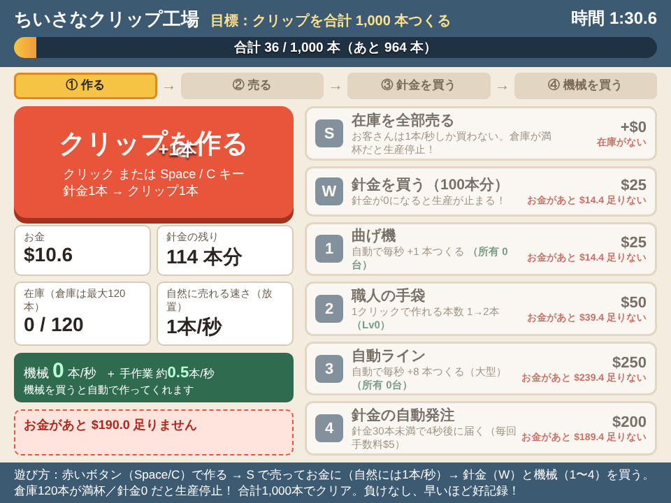
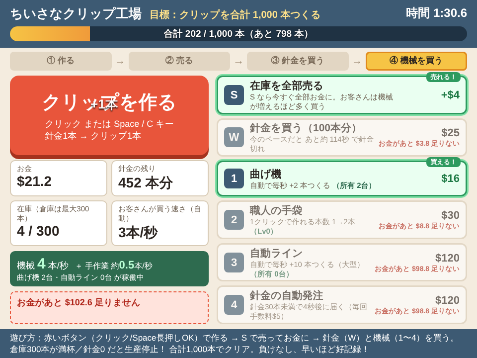

# paperclip の生成レポート

- 結果: **停滞で終了**（ベストは2周目、スコア 0.8）
- brief: `briefs/paperclip.md`
- 周回数: 5、費用: $8.47

## スコアの推移

| 周 | スコア | 機械判定 | 試遊 | 結果 | 費用 |
| -- | -- | -- | -- | -- | -- |
| 1 | 0.59 | 15/15 | 0.42 | neither | $1.67 |
| 2 | 0.8 | 15/15 | 0.71 | won | $1.55 |
| 3 | 0.8 | 15/15 | 0.71 | neither | $2.02 |
| 4 | 0.65 | 15/15 | 0.5 | neither | $1.18 |
| 5 | 0.77 | 15/15 | 0.67 | won | $1.87 |

`▅▇▇▆▆`

## 1周目

機械判定はすべて通過。

試遊AI: 画面の案内と操作の反応は良好だが、ヒントどおりに最初に曲げ機を買うと針金が買えなくなって永久に詰む序盤の経済バグがあり、序盤のテンポも遅いため、このままでは安心して遊べない。

- 不具合: ヒント通り最初に曲げ機($15)を買うと、初期針金40本を売り切っても所持金が$24.9で針金($25)が買えず、針金0・お金増加なしの永久詰みになる（売値が実質約$0.98/本のため）
- 不具合: 所持金が「$25.0」と表示されているのに針金ボタンは『お金があと $1 足りない』と出る（小数の丸め表示の不一致）
- 不具合: 針金0・お金不足の詰み状態で『クリップを作って売ろう』と実行不可能な指示を出す
- 不具合: 『在庫を全部売る』（売る操作）に『買える！』バッジが表示される
- 修正依頼: 詰み防止：針金0かつ所持金<針金価格のときは手で1本作れる救済（例：『くず針金を拾う』で数本補給）を入れるか、初期針金を50本以上にする／初回の針金を$15程度に下げる。売値も表示通りの$1にそろえる
- 修正依頼: 序盤のテンポ改善：曲げ機を2本/秒にする、または最初のヒントを『まず針金を買い足してから曲げ機』の順にして、機械購入後に生産の伸びがはっきり体感できるようにする
- 修正依頼: 所持金の表示を切り捨てにする（$24.9 なら $24.9 と出す）、不足額の表示も小数第1位まで出して見た目と購入可否を一致させる。売るボタンのバッジは『売れる！』にする

## 2周目

機械判定はすべて通過。

試遊AI: 画面だけで遊び方が分かり、機械を買うたびに生産ペースが上がる気持ちよさは brief どおりにできている。ただ 1:45 でクリアでき、終盤は自動化で放置に近くなり、針金切れの判断も起きないため、手応えと「もう一回」の動機が弱い。

- 不具合: 想定3〜4分のところ 1:45.2 でクリアでき、職人の手袋は一度も買わずに済んだ（難易度が低すぎる）
- 不具合: 自動発注＋自動ライン購入後は、売る・針金をまったく押さずに待つだけで残り約300本が完成し、終盤はほぼ放置でクリアできる
- 不具合: 1回分の行動（約0.15秒）ではクリップは1本しかできず、クリック連打でしか手作業を進められない
- 修正依頼: 全体の進行を遅くして3〜4分に合わせる：曲げ機の値段の上がり方を強くする（$15→$18→$22…をもっと急に）、自動ラインを$300以上にする、売値か機械の生産量を下げる
- 修正依頼: 自動発注を「1回ごとに手数料がかかる」「在庫が30を切ってから補充までに数秒遅れる」などにして、生産速度が上がると針金切れが実際に起きるようにし、手動で針金を買う判断を残す
- 修正依頼: 自然に売れる速さを画面に数字で出す（例：自動販売 3本/秒）。在庫がたまる理由と S を押す意味が分かるようにする。手袋の効果も数字で比べられるようにして、買う価値を見せる

## 3周目

機械判定はすべて通過。

試遊AI: 画面だけで遊び方・次に買うもの・針金切れの危険がよく分かり、UIの完成度は高い。ただ中盤以降の機械投資による伸びが緩く、3分経っても自動ラインに届かず、数字が増える気持ちよさがあまりない。

- 不具合: 売却時の「+$NN」フロート文字が「在庫を全部売る」の見出しに重なって読みにくい
- 不具合: 職人の手袋の説明が非クリック時に『手作業 約0.0→0.0本/秒』となり、効果が読み取れない
- 修正依頼: 中盤の加速を強める：曲げ機の値上がり率を下げる（例 ×1.15）か、自動ラインを$250前後に下げ、曲げ機4〜5台の時点で手が届くようにする（3分時点で420本、毎秒4本止まりでは『機械で伸びる』実感が弱い）
- 修正依頼: 職人の手袋の効果表示を『1クリックで作れる本数 1→2本』のように固定の値にし、クリックの速さで0.0になる表記をやめる
- 修正依頼: 売却時の +$ ポップアップをボタンの見出しと重ならない位置（お金の欄の上など）に出す

## 4周目

機械判定はすべて通過。

試遊AI: 画面での説明・買える物の目立たせ方・針金切れの救済は丁寧で分かりやすい。ただ経済のテンポが遅く、機械を足しても伸びが小さいので、briefの『3〜4分でクリア』と『機械を買うとはっきり速くなる』気持ちよさに届いていない。

- 不具合: 針金切れで赤ボタンが「くず針金を拾う（+5本）」に変わると、文字が折り返してボタンからはみ出し、左端の「く」が切れる
- 不具合: 2:48 経過・機械5台でも 401/1000 本。曲げ機の値上がり（25→29→33→44→50）が速く、自然販売も $1/秒 で頭打ちなので、briefの『3〜4分でクリア』に届かないペース
- 不具合: Space を2秒押し続けても1本しか作れず、手作業の生産が序盤の大きな負担になる（最初の機械まで約25回クリック）
- 修正依頼: 序盤〜中盤を速くする：曲げ機の初期価格を $10〜15 にして値上がりを緩くし、自然販売の速さを機械台数に応じて上げる（または『お客さん』のアップグレードを足す）。3〜4分でクリアできるか実測して調整する
- 修正依頼: 機械を買ったときにペースの上がり方がはっきり見えるようにする：曲げ機を +2本/秒 にするか、自動ラインを $120 前後にして中盤の目標を近づける
- 修正依頼: 赤ボタンの見出しを、ボタン内に1行で収まる長さ・サイズにする（例「くず針金 +5」）

## 5周目

機械判定はすべて通過。

試遊AI: 画面の案内と「買える／足りない」表示がとても丁寧で、作る→売る→針金→機械の流れが迷わず分かる。ただ長押しが強すぎて1分ちょっとでクリアでき、後半は針金待ちと放置になるので、達成感と判断の手応えが薄い。

- 不具合: 手袋購入後、作るボタンに「針金1本 → クリップ2本」と出るが、実際は1本につき針金1本を消費する（74→26本で48本生産）。表示が誤解を招く
- 不具合: Space長押しのリピートで約7クリック/秒の手作業になり、手作業だけで6〜12本/秒出る。想定3〜4分のところ1:06でクリアできてしまう
- 不具合: 後半は針金の消費が約25本/秒なのに、自動発注・Wとも100本単位なので約4秒ごとに針金切れで止まり、待つだけの時間になる
- 修正依頼: 1,000本が1分で終わるので、バランスを直してクリアを3〜4分に伸ばす（長押しの連打を約3回/秒までに制限する、機械の値段を上げる、自動ラインの性能を下げる、などで）
- 修正依頼: 後半の針金の買い方を直す（購入量を消費に合わせて増やす、まとめ買い割引、自動発注の量を強化できるようにする）。何度も止まって待つだけにならないようにする
- 修正依頼: 手袋の説明を『1回押すとN本（針金もN本使う）』に直す。あわせて、自動発注と自動販売が揃った後は放置で進みすぎないよう、お客さんの自動購入を遅くするか、売値を下げるなどで手で売る意味を残す

