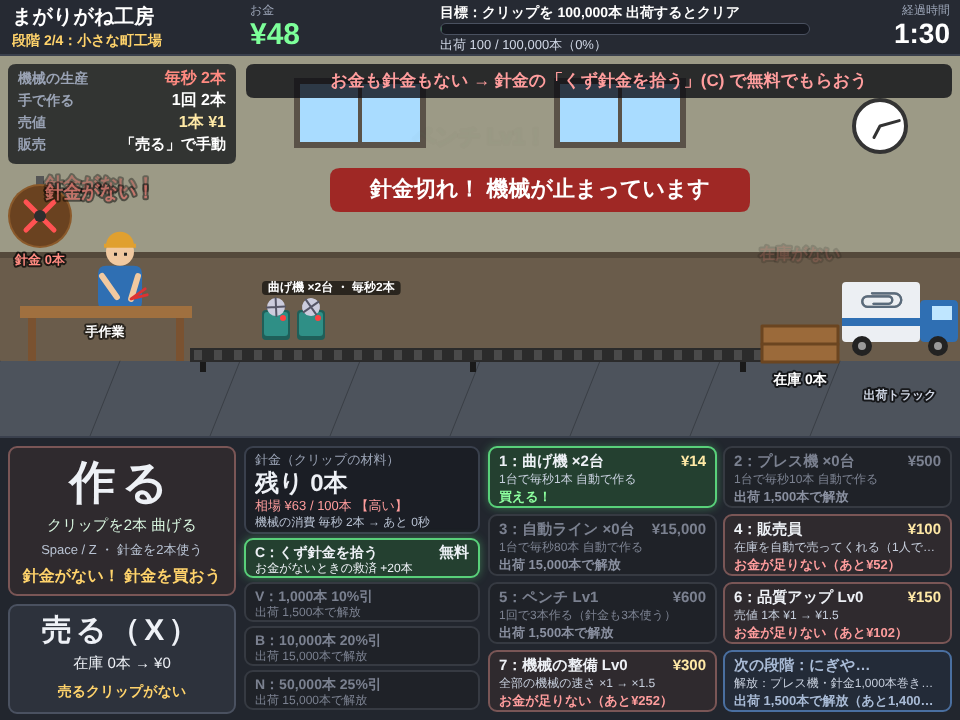
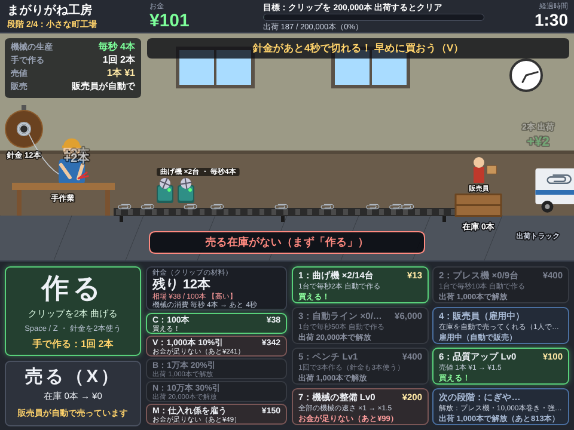

# paperclip の生成レポート

- 結果: **完成**（ベストは2周目、スコア 0.85）
- brief: `briefs/paperclip.md`
- 周回数: 2、費用: $8.95

## スコアの推移

| 周 | スコア | 機械判定 | 試遊 | 結果 | クリア時間 | 費用 |
| -- | -- | -- | -- | -- | -- | -- |
| 1 | 0.73 | 16/16 | 0.61 | neither | - | $4.33 |
| 2 | 0.85 | 16/16 | 0.78 | won | 7分19秒 | $4.44 |

`▆▇`

## 1周目

機械判定はすべて通過。

試遊AI: 見た目・分かりやすさ・画面の安定はかなり良く、作る→売る→針金→機械の流れも画面だけで分かる。ただし10万本のクリアが遠すぎて目安の6〜10分に収まらず、段階3では10秒ごとの針金補充が作業になって楽しさを削っている。

- 不具合: 「作る」(Space/クリック) を約0.15秒間隔で押すと半分ほどが無視される。12回押して6本しかできず、無視されたことが画面に出ない
- 不具合: 機械を買ったときの『曲げ機 稼働！』『プレス機 稼働！』が機械ラベル（×台・毎秒◯本）に重なって読めない
- 不具合: 段階3で毎秒91本を消費するのに、針金は最大1,000本巻き（約11秒分）しか買えず、すぐ針金切れで全機械が止まる。ほぼ10秒ごとに補充が要る作業になっている
- 不具合: 6分35秒で出荷8,620/100,000本（8.6%）。上手に遊んでも目安6〜10分を大きく超えそうなペース
- 修正依頼: クリアまでのペースを6〜10分に合わせる：目標本数を下げる（例：30,000〜40,000本）か、段階3〜4の生産量の伸び（プレス機の効果、自動ラインの解放を早める等）を強めて、上手な人が7〜9分でクリアできるようにする
- 修正依頼: 針金の補充が10秒ごとの作業にならないようにする：10,000本巻きを段階3（1,500本）で解放する、針金を自動で買う『仕入れ係』を設備として追加する、消費量に応じてリールの容量を増やす、のいずれか
- 修正依頼: 『作る』の受付時間を短く（0.1秒以下）するか、押した分をキューに入れて全部反映させる。『稼働！』のポップアップは機械ラベルと重ならない位置（ラベルの上か画面中央）に出す

## 2周目

機械判定はすべて通過。

試遊AI: 絵とアニメーションが豊かで、作る→売る→針金→機械の流れが画面だけで分かり、レイアウトシフトもゼロと完成度は高い。ただし設備が5分で上限に達し、残り2分が放置だけになるので、最終段階の中身が足りない。

- 不具合: 5:08で全設備が上限になり、7:09のクリアまで約2分、買える物も判断もなく待つだけになった。お金は¥289,387まで使い道なく貯まった
- 不具合: ボタン文言が省略記号で切れて読めない（『3：自動ライン ×0/…』『次の段階：にぎや…』『在庫を自動で売ってくれる（1人で…』）
- 不具合: Spaceを3秒押し続けてもクリップが1本しかできず、押しっぱなしで連続生産できない
- 不具合: ペンチ（5）と手作りが序盤の10本以降ほぼ意味を持たず、一度も買う理由がなかった
- 修正依頼: 最終段階（大工場）に、余ったお金の使い道と判断を足す。例：自動ラインの上限を段階的に増やす、ワイヤー工場を建てて自前で針金を作る、注文が来たら手作業の特急便で応える、など。5分すぎから2分間ただ待つだけの時間をなくす
- 修正依頼: 設備カードの説明文が1行に収まるよう、文言を短くするかカードを広げる。上限台数や販売員の能力が省略されず読めるようにする
- 修正依頼: 手作業とペンチを終盤まで意味のあるものにする（例：手作りは生産の数%を足す、クリックでしばらく機械を加速する）。あわせてキーの押しっぱなしで連続生産できるようにする

