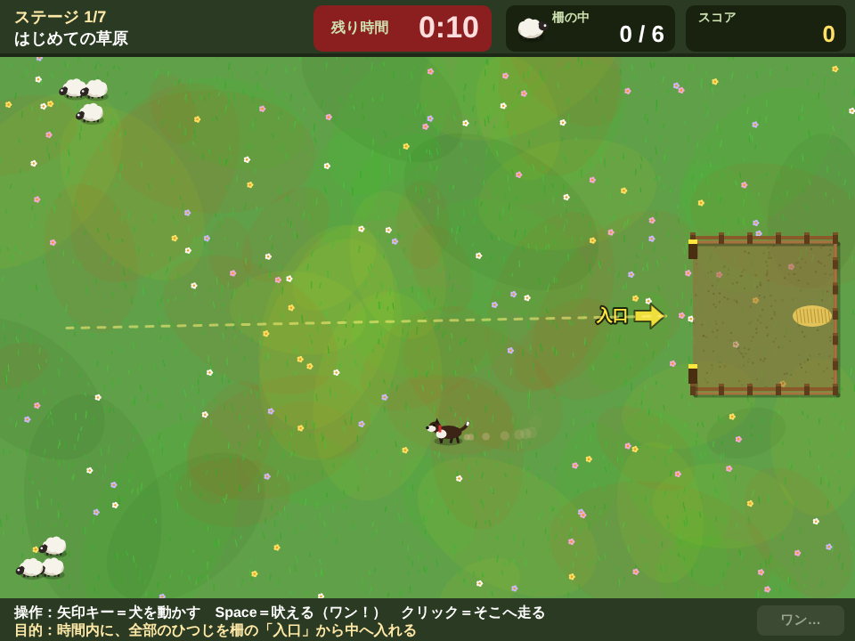
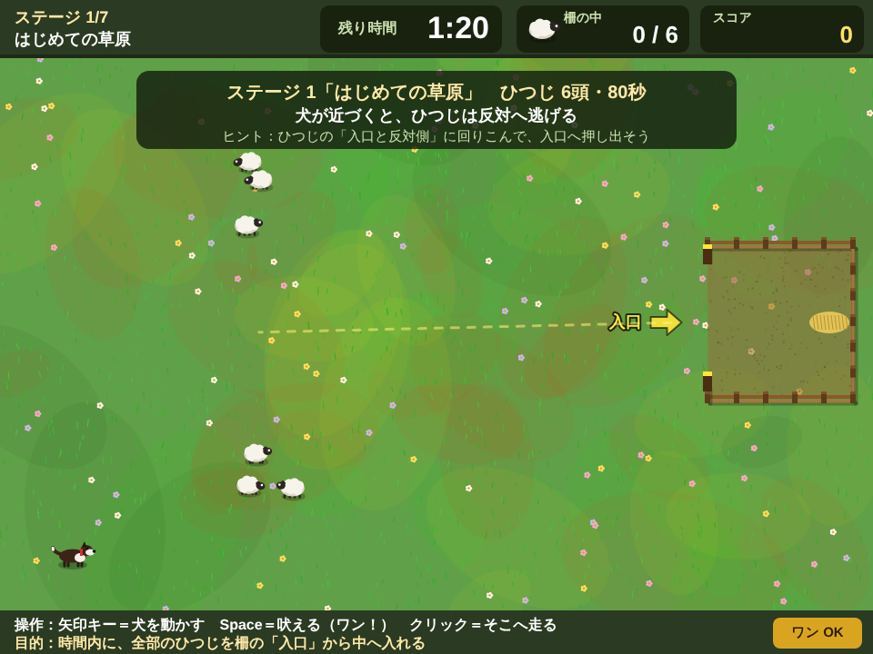
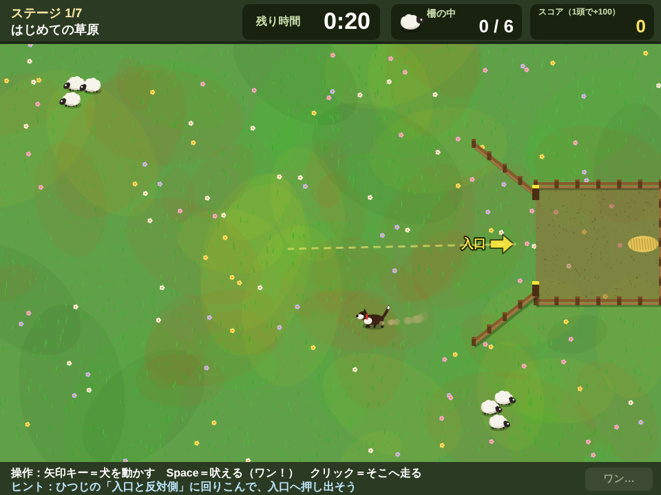
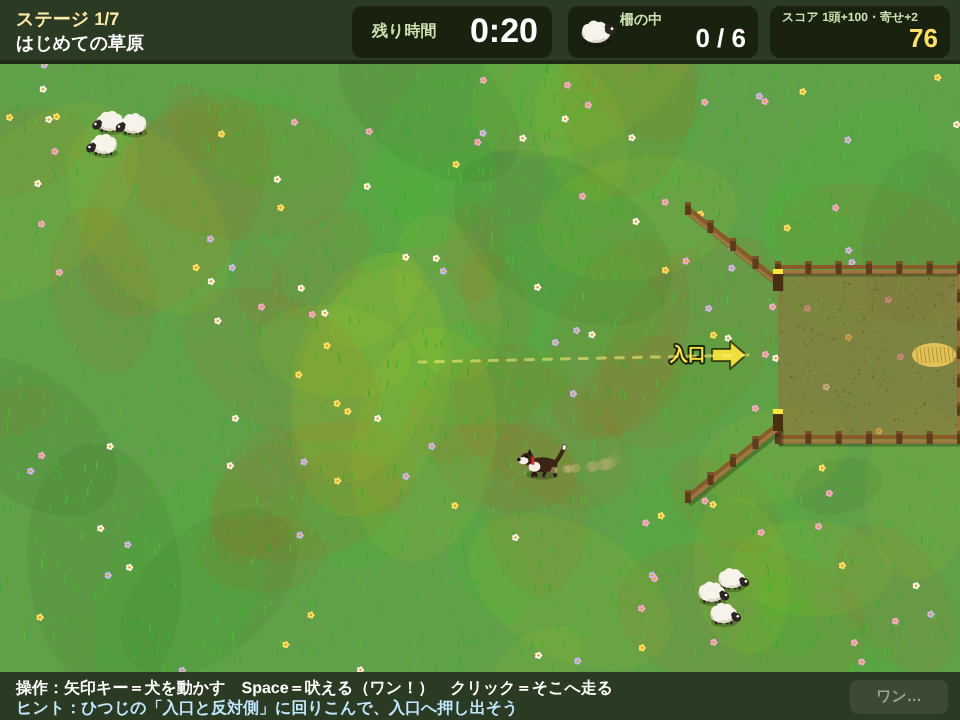
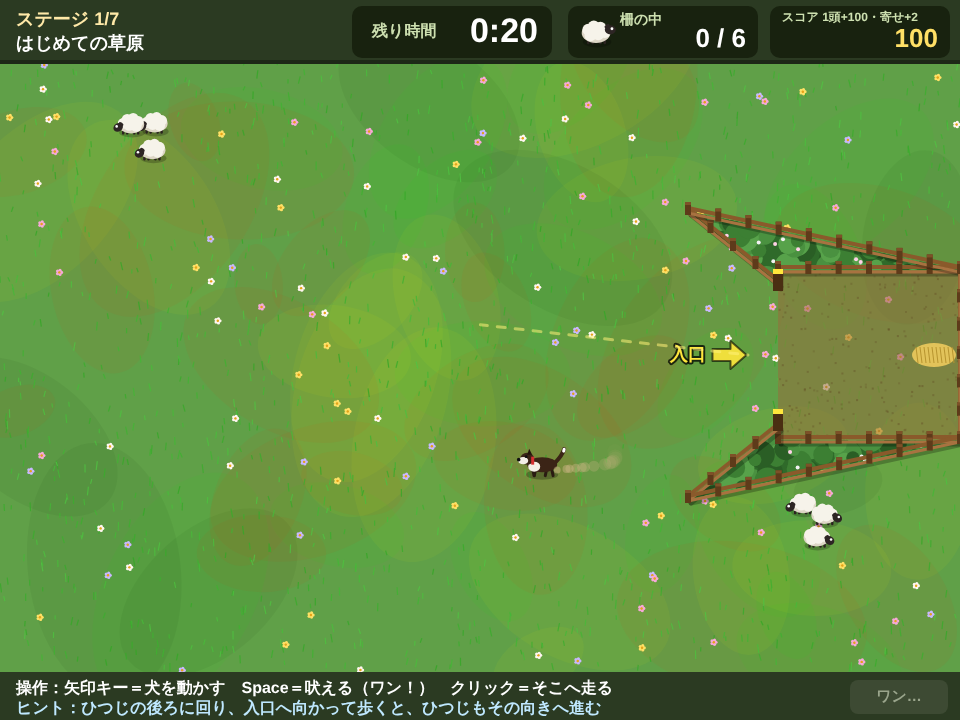
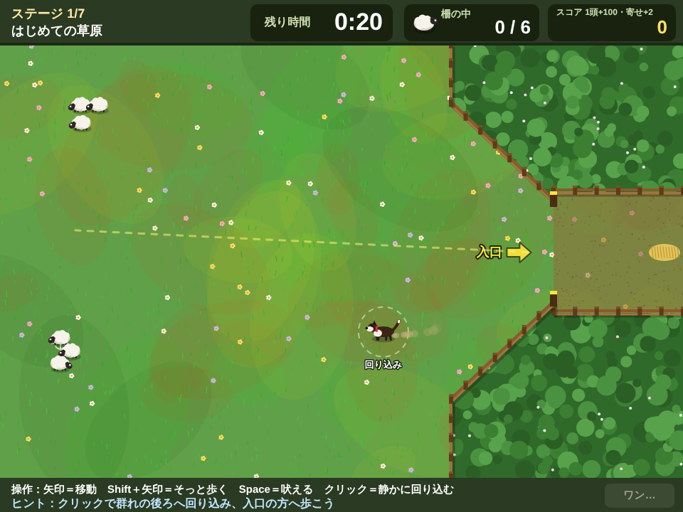

# sheepdog の生成レポート

- 結果: **費用上限で終了**（ベストは4周目、スコア 0.78）
- brief: `briefs/sheepdog.md`
- 周回数: 6、費用: $17.04

## スコアの推移

| 周 | スコア | 機械判定 | 試遊 | 結果 | クリア時間 | 費用 |
| -- | -- | -- | -- | -- | -- | -- |
| 1 | 0.28 | 15/16 | - | - | - | $1.93 |
| 2 | 0.65 | 17/17 | 0.5 | lost | - | $3.53 |
| 3 | 0.28 | 15/16 | - | - | - | $1.52 |
| 4 | 0.78 | 16/16 | 0.69 | lost | - | $3.41 |
| 5 | 0.67 | 16/16 | 0.53 | lost | - | $4.40 |
| 6 | 0.28 | 15/16 | - | - | - | $2.05 |

`▃▆▃▆▆▃`

## 1周目

機械判定で落ちた項目: game_progresses

## 2周目

機械判定はすべて通過。

試遊AI: The art, screen stability and the clarity of the goal are good, but the dog is too fast, sheep flee sideways and get stuck at edges and corners, and I couldn't clear stage 1 in two tries. So I never saw stage 2 or the stage-by-stage additions the brief asks for.

- 不具合: Dog moves much faster than a fleeing sheep. A short key hold runs the dog into the flock or past it, so you can't push from behind.
- 不具合: Sheep don't flee directly away from the dog. Coming in from the left at the same height sends them up or down instead of right, toward the entrance.
- 不具合: Sheep pile up at the top-right corner, along the pen's top fence and in the gap between the pen and the right screen edge, and can barely be moved back out.
- 不具合: Score keeps rising with 0 sheep penned. The screen doesn't explain what the score is for.
- 不具合: The stage-start banner stays over the top of the field for several seconds and covers sheep and the dog's path.
- 修正依頼: Make the dog slower than a fleeing sheep (about 0.8x), and slow the dog further when it is close to sheep. Make sheep flee straight along the line from the dog through the sheep. That way pushing from behind visibly moves the flock forward.
- 修正依頼: Stop sheep from getting stuck: steer them back toward the middle near screen edges, and close the gap between the pen and the right edge (or move the pen in from the edge). Also add a funnel-shaped guide fence at the entrance so stage 1 can be cleared in 60–90 seconds.
- 修正依頼: Remove the rising score or say on screen what it measures (for example only the time bonus when a sheep enters the pen). Shrink the start banner to the top bar or fade it out within 2 seconds.

## 3周目

機械判定で落ちた項目: game_progresses

## 4周目

機械判定はすべて通過。

試遊AI: 絵と画面の安定は優秀で、犬の位置でひつじが動く手ごたえもあるが、ひつじが横へそれやすく柵の外側に詰まるので、追い込みが気持ちよさより手間に感じる。ステージ1は110秒中約71秒でクリアしたが、ステージ2（岩・10頭）は2/10頭で時間切れだった。

- 不具合: ひつじが漏斗の壁の外側や柵の上辺の外に挟まって動けなくなり、大回りして救出するしかない
- 不具合: 柵の上辺の外側にひつじが溜まり、入口へ戻すのに十数手かかった
- 不具合: クリック移動で犬が群れの中を一直線に突っ切り、群れが散る
- 不具合: 犬が少し斜め後ろにいるだけで、ひつじが押す方向ではなく横に大きくそれる。まっすぐ押せない
- 不具合: ステージクリア画面の直後の Enter が無視される（約1.5秒の入力ロック。表示がないので効かないように見える）
- 修正依頼: ひつじの逃げる向きを『犬からひつじへの向き』にもっと揃え、横へそれる成分と速さを弱める。合わせて、犬が群れのすぐそばに来たら自動で少し減速させ、追い越して逆に追い返さないようにする
- 修正依頼: 漏斗の壁の外側と柵の外周に、ひつじを外へ押し返す弱い力か、角を丸めたすべり面をつけ、外側の角に溜まらないようにする
- 修正依頼: クリック移動は群れを避けて回り込む経路にする（または群れの手前で止まる）。クリア画面は入力を受け付けない間『…』を出すか、ロックをなくす

## 5周目

機械判定はすべて通過。

試遊AI: The drawing and screen stability are very good, but stage 1's herding fights the player: sheep scatter early and get stuck at the edges, so I lost twice and never saw stages 2–7. The core feel of steering the flock with the dog's position needs tuning first.

- 不具合: Sheep react from too far away (about 100–120px) and run directly away from the dog, so going around behind them scatters them first. In stage 1 I could not get the group to the entrance, and it took two attempts to get 1 of 6 in
- 不具合: Sheep pile up on the top edge, in the top-right corner and on the outside of the pen/funnel walls, and it is very hard to get them back out (a sheep sat on top of the pen fence)
- 不具合: A sheep that reaches the inside corner of the funnel slips back out over the top wall
- 不具合: While moving to a clicked spot, the dog drives away any sheep along its path, so clicking to reposition breaks up the herd
- 修正依頼: For stage 1, reduce the sheep's reaction distance to about 60–70px and make them drift in the dog's direction of travel rather than straight away from the dog, so 'walking toward the entrance from behind' clearly works
- 修正依頼: Add a soft force near the screen edges and the outside of the pen that steers sheep back toward the middle, and make the funnel walls longer and wider so it guides sheep in
- 修正依頼: Provide a way to approach slowly (for example, holding Shift to walk) so the hint 'push gently' can actually be done, and shrink the sheep's reaction distance while walking

## 6周目

機械判定で落ちた項目: game_progresses

